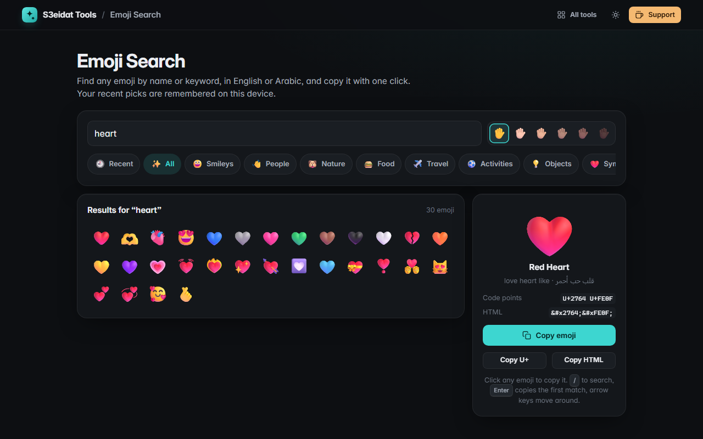

# Emoji Search

> Find and copy any emoji fast, in English or Arabic. Free, private, and it runs entirely in your browser.

### ▶ [Open Emoji Search](https://s3eidat.github.io/emoji-search/)



## Features

- **1,250+ emoji** with names and keywords, including 89 country flags
- **Search in English or Arabic** (`heart`, `party`, `قلب`, `شكرا`, `الأردن`). Arabic search ignores diacritics and hamza/taa-marbuta spelling differences
- **Categories**: smileys, people, nature, food, travel, activities, objects, symbols, flags
- **Skin tone** picker, applied to every emoji that supports it
- **Click to copy**; the details panel shows code points (`U+1F44D`) and the HTML entity (`&#x1F44D;`), each copyable
- **Recently used** emoji remembered on this device
- Keyboard friendly: <kbd>/</kbd> to search, <kbd>Enter</kbd> copies the first match, arrow keys move around the grid

The emoji list is a curated set authored for this tool and embedded in the page, so it works offline. How each emoji
looks depends on your device's emoji font.

## Privacy

Everything runs on your device. Only your recent emoji, skin tone and last category are kept in this browser's local storage.
There is no server, no account, no analytics. The page ships with a strict Content-Security-Policy
(`connect-src 'self'`), so the browser itself blocks any attempt to send data anywhere.

## Run it yourself

It's plain HTML, CSS and JavaScript with no build step:

```bash
git clone https://github.com/s3eidat/emoji-search
cd emoji-search
python -m http.server 8000
```

Then open http://localhost:8000.

## Support

If this saved you time, **[buy me a coffee ☕](https://s3eidat.github.io/coffee/)**. It keeps every tool free.

---

Part of **[S3eidat Tools](https://s3eidat.github.io/)**: 100+ free, private tools that run in your browser. MIT licensed.
